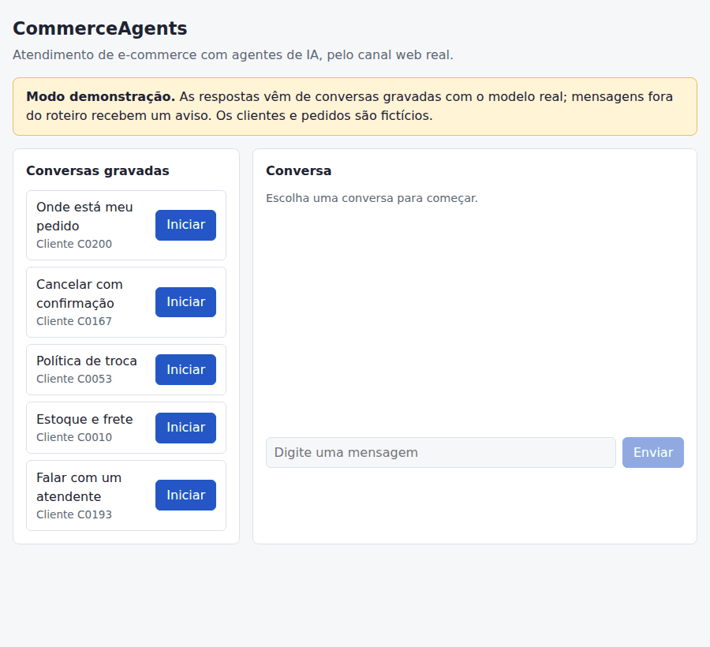
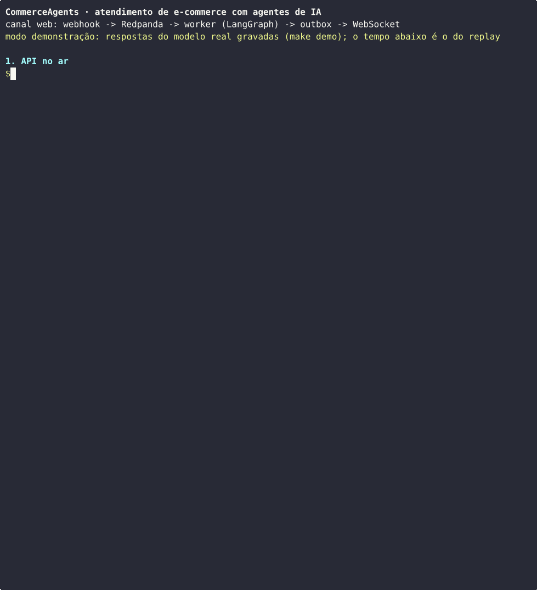
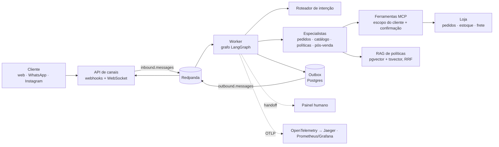
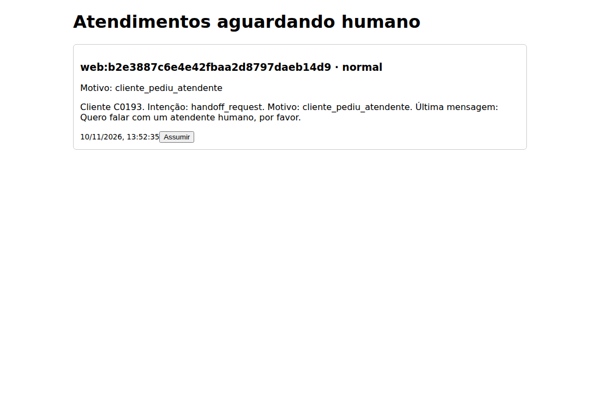
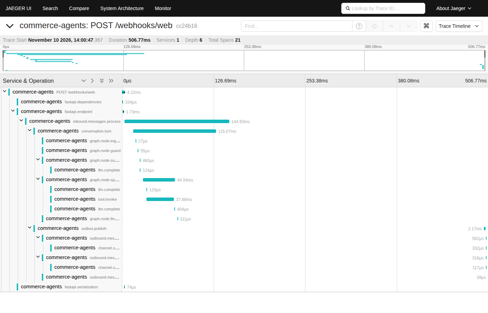
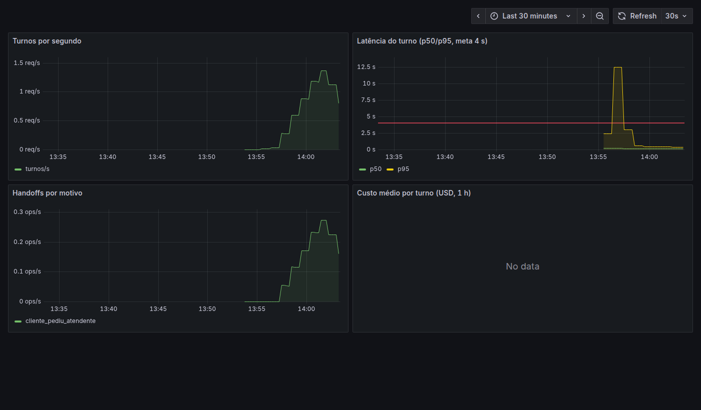

# CommerceAgents

Atendimento e vendas por agentes de IA para um e-commerce de moda e calçados, construído de ponta a
ponta como se fosse para produção: agentes com ferramentas reais, confirmação obrigatória para ações
irreversíveis, handoff para humano, avaliação automatizada, resiliência, observabilidade e teste de
carga.

> **Case de portfólio.** A loja (**TH Multimarcas**), os clientes, os pedidos e as políticas são
> fictícios, gerados para o projeto; os canais de WhatsApp e Instagram são simulados. Os números
> abaixo foram medidos neste repositório, com o modelo real quando indicado.



## Experimente sem chave de API e sem servidor

```bash
git clone https://github.com/Cainan-bn/Commerce-agents.git && cd Commerce-agents
make demo        # sobe a stack de produção em modo demonstração e mostra as URLs
make demo-down   # derruba tudo
```

- Chat de demonstração: <http://localhost:8000/demo> (escolha um cliente e use as mensagens sugeridas)
- Painel do atendente humano: <http://localhost:8000/panel>
- Traces (Jaeger): <http://localhost:16686> · Métricas (Grafana): <http://localhost:3001>

No modo demonstração o LLM responde a partir de conversas gravadas com o modelo real
(`claude-haiku-5-5`); todo o resto roda de verdade: webhook, Redpanda, workers, grafo de agentes,
ferramentas sobre a loja, RAG de políticas, outbox e WebSocket. Mensagem fora do roteiro recebe um
aviso de modo demonstração. Também roda no **GitHub Codespaces** (`.devcontainer/`). Com uma chave
própria de um provider compatível com OpenAI (`LLM_PROVIDER=openai-compatible`), o mesmo sistema
conversa livremente. Os segredos que o `make demo` usa são valores locais de demonstração, não
configuração de produção. Detalhes no [ADR 0020](docs/adr/0020-distribuicao-e-modo-demonstracao.md).

A loja simulada guarda o estado em memória: conversas que mudam dados (o cancelamento) funcionam uma
vez por subida; `make demo-reset` reinicia a loja para repetir. Nos GIFs, as respostas são do modelo
real e o tempo é o da reprodução gravada, não a latência do LLM (a latência medida está em
[Resultados](#resultados-medidos)).

<details>
<summary>A mesma conversa só com cURL (webhook + WebSocket)</summary>



`scripts/demo_curl.sh`
</details>

## O problema

Uma loja online pequena perde vendas fora do horário comercial, e o time gasta a maior parte do
tempo com perguntas repetitivas: status de pedido, tamanho em estoque, prazo de frete, política de
troca. A resposta precisa usar os dados reais da loja (nunca inventar), não pode executar ação
irreversível sem o cliente confirmar, e tem de passar para um humano quando não resolver.

## Arquitetura



- **Clean Architecture** (`domain → application → infrastructure → interfaces`), imposta por
  import-linter no CI; Pydantic v2 estrito nas fronteiras; `mypy --strict`.
- **Agentes:** supervisor com roteador de intenção e especialistas; cada um vê só as ferramentas do
  seu escopo. Ferramentas validam que o pedido pertence ao cliente identificado.
- **Ações irreversíveis** (cancelar, abrir devolução) só com token de confirmação emitido pelo
  servidor e consumido uma única vez; o LLM nunca vê o token.
- **Mensageria:** Redpanda com chave por conversa (ordem garantida), outbox transacional, envio
  idempotente durável e purga periódica.
- **Resiliência:** circuit breaker e fallback entre providers; sem LLM, a conversa vai para humano.
- **Observabilidade:** um trace por mensagem, do webhook ao envio da resposta (passando pelo broker
  e pelo outbox); métricas de latência, custo, erros e circuito; dashboards e alertas versionados.

Decisões registradas em [20 ADRs](docs/adr/); visão C4 e modelos em [`docs/architecture/`](docs/architecture/).

## Resultados medidos

**Qualidade do agente** (54 cenários de avaliação, métricas determinísticas, modelo real;
[relatório](docs/evals/relatorio-fase-08.md)):

| Métrica | Antes do ajuste | Depois |
|---|---|---|
| Cenários resolvidos corretamente | 51,9% | **70,4%** |
| Ferramenta certa | 77,8% | **98,1%** |
| Ação irreversível sem confirmação | 0 | **0** |
| Vazamento de dados de outro cliente | 0 | **0** |

Cada ajuste de prompt ou contrato de ferramenta foi uma hipótese medida isoladamente, com teste
antes da implementação. Num conjunto separado de 12 cenários, nunca usado nos ajustes, o agente
resolveu 33,3%, com os mesmos gates de segurança em 100%: a distância para o conjunto de ajuste está
analisada no relatório e é o principal limite conhecido. O CI reproduz um subconjunto gravado a cada
PR e barra regressões ([ADR 0016](docs/adr/0016-gate-de-eval-no-ci-por-replay.md)).

**Sistema** (k6 numa máquina de 2 núcleos, LLM simulado a ~800 ms;
[relatório](load/reports/20261110-fase09.md), [ADR 0019](docs/adr/0019-resultados-de-carga-e-gargalos.md)):

| Meta | Medido |
|---|---|
| Webhook até enfileirar, p95 < 150 ms | 24,5 ms a 38 req/s; 89,6 ms a 88 req/s (um processo) |
| Primeira resposta com LLM, p95 < 4 s | **3,10 s** |
| Queda do provider de LLM | 0 mensagens sem resposta; handoff para humano ou fallback |
| Queda do provider com fallback, p95 | 30,9 s → **7,3 s** após limitar novas tentativas ao último provider |
| Trace por mensagem | 1 trace com os 8 saltos, do webhook ao envio |
| Custo por conversa | ~**US$ 0,0076** (eval completo com o modelo real) |

Mais de 1.200 testes unitários e 130 de integração; cobertura de 90%; imagem com varredura Trivy
sem vulnerabilidade crítica ou alta corrigível.

| Painel humano em handoff | Trace de ponta a ponta | Dashboard de atendimento |
|---|---|---|
|  |  |  |

No dashboard, o custo aparece sem dados porque o modo demonstração não chama um LLM pago (custo
desconhecido é `None`, nunca um zero inventado); o pico inicial de latência é o carregamento do
modelo de embeddings na primeira consulta de uma stack nova.

## Limites conhecidos

- O agente resolve bem menos no conjunto separado de avaliação (33,3%) do que no de ajuste (70,4%):
  não propõe abrir devolução quando o cliente pede, e recusa de forma vaga quem tenta consultar
  pedido de outra pessoa (a ferramenta barra, mas a resposta poderia ser melhor).
- Mensagens ambíguas de cliente identificado: o agente lista os pedidos em vez de perguntar o que o
  cliente quer; o contrato desse comportamento ainda é decisão de produto.
- O agente às vezes oferece "preparar o pedido", ação que não existe no sistema.
- O worker processa uma mensagem por vez por partição; a escala é por partições e réplicas
  (`docker-compose.prod.yml`), não medida com mais de uma máquina.
- Canais WhatsApp/Instagram são adapters testados contra a especificação, sem conta real.

## Decisões de design e trade-offs

- **O LLM decide, o servidor garante.** Escopo do cliente, posse do pedido e confirmação de ações
  irreversíveis são verificados fora do modelo (`ScopedToolInvoker`, preflight e token de uso único
  que o LLM nunca vê). Prompt injection pode mudar o que o modelo tenta, não o que o sistema executa
  ([ADR 0010](docs/adr/0010-defesa-contra-prompt-injection.md), [0011](docs/adr/0011-consumo-do-token-no-servidor-da-ferramenta.md)).
- **Avaliação antes de ajuste.** Baseline fixado antes de mexer em prompt; uma hipótese por vez,
  medida contra o run anterior; métricas determinísticas como critério e juiz LLM calibrado contra
  rótulos humanos só como sinal secundário; erros de infraestrutura fora das taxas; holdout rodado
  uma única vez ([ADR 0015](docs/adr/0015-provider-openai-compativel-e-simulador-por-regra.md)).
- **Gate de CI hermético por replay.** O eval real não é determinístico nem barato; o CI reproduz
  respostas gravadas e barra regressões de lógica e de segurança. O custo: mudar prompt exige
  regravar com o modelo real, o que obriga a medir antes de mudar ([ADR 0016](docs/adr/0016-gate-de-eval-no-ci-por-replay.md)).
- **Degradar para humano, não para esclarecimento.** Sem LLM, o roteador não classifica a mensagem
  como ambígua (o cliente ficaria preso pedindo esclarecimento): a conversa vai para um atendente.
  Resposta malformada continua tratada como ambígua ([ADR 0017](docs/adr/0017-resiliencia-do-provider-de-llm.md)).
- **Novas tentativas só no último provider da cadeia.** Com fallback configurado, repetir no
  primário só atrasa a troca; medido no caos: p95 de 30,9 s para 7,3 s ([ADR 0019](docs/adr/0019-resultados-de-carga-e-gargalos.md)).
- **Sem cache semântico.** As respostas dependem de dados do cliente e da loja; um acerto falso daria
  informação errada ou de outra pessoa. O ganho ficaria restrito a perguntas de política, que já são
  baratas.
- **Escala por partição, não por concorrência no worker.** A chave `conversation_id` garante ordem
  por conversa; réplicas no mesmo grupo de consumo escalam sem fila por conversa no código.
- **Privacidade na telemetria.** Spans e métricas levam identificadores e números, nunca texto do
  cliente, prompt ou token; nenhum identificador de conversa vira label de métrica
  ([ADR 0018](docs/adr/0018-observabilidade-com-opentelemetry.md)).

## Processo de engenharia

Desenvolvido em fases, com ADR antes de cada decisão significativa, testes escritos antes da
implementação e um PR por fase com CI verde (lint, `mypy --strict`, contratos de arquitetura,
unitários, integração, gate de avaliação, build da imagem com Trivy). Medições e revisões acharam
defeitos que testes de unidade não pegavam, todos registrados com a correção: histogramas na escala
errada (todo p95 abaixo de 5 s aparecia como 4,75 s), trace partido no outbox, 161 testes de domínio
fora do gate do CI, token de sessão no log de acesso, dependências de runtime declaradas só como
dependências de desenvolvimento. Histórico por fase em [`docs/orchestration/`](docs/orchestration/).

## Desenvolvimento

Pré-requisitos: Docker, `uv`, Python 3.12 (ou o devcontainer). No WSL2, mantenha o repositório no
filesystem Linux.

```bash
make setup && make up          # dependências e stack local (Postgres, Redpanda, observabilidade)
make lint && make test-unit    # ruff, mypy --strict, import-linter; testes unitários
make test-integration          # Postgres e Redpanda
make eval-ci                   # gate de avaliação por replay (sem LLM)
make demo-verify               # modo demonstração na stack de produção, falha fora do roteiro
make load                      # carga e caos com k6 (ver load/README.md)
make up-langfuse               # opcional: spans de LLM no Langfuse (exige LANGFUSE_OTLP_AUTH)
```

Imagens publicadas no GHCR a cada versão (`.github/workflows/release.yml`).
