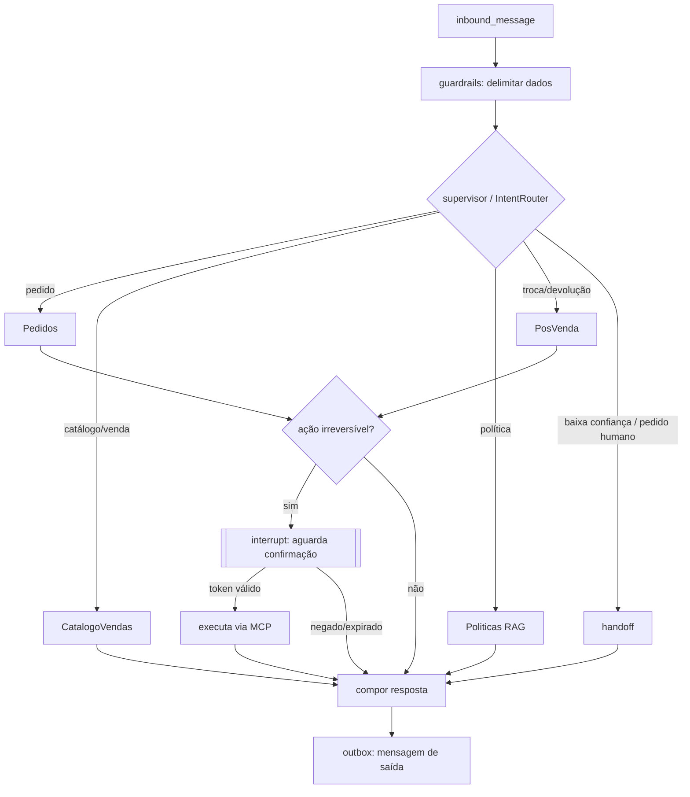

# 0003. LangGraph como orquestrador multi-agente e checkpointing em PostgreSQL

- Status: Accepted
- Data: 2026-11-05

## Contexto e problema

O atendimento exige roteamento por intenção, especialistas com ferramentas distintas, pausa para confirmação humana e retomada após falhas. A execução precisa ser durável.

## Direcionadores

- Human-in-the-loop nativo para ações irreversíveis.
- Estado explícito e tipado.
- Retomada após crash sem perder a conversa.

## Opções consideradas

1. LangGraph (Supervisor + especialistas) com checkpointer PostgreSQL.
2. Loop de agente manual.
3. Outro framework multi-agente.

## Decisão

Opção 1. Um nó `supervisor` roteia (via port `IntentRouter`) para os especialistas `Pedidos`, `CatalogoVendas`, `Politicas` e `PosVenda`. Cada especialista possui uma **allowlist** de ferramentas. Ações irreversíveis passam por um nó de interrupção (`interrupt_before`) que só continua com confirmação válida (ADR 0008). Checkpoints ficam no PostgreSQL (`langgraph-checkpoint-postgres`), com `thread_id = conversation_id`.

## Consequências

- Positivas: durabilidade, interrupções e estado tipado prontos.
- Negativas: acoplamento da camada `infrastructure/agents` ao LangGraph. O domínio e os casos de uso não o conhecem.
- A decisão de executar ação irreversível é determinística (código), nunca só do LLM.
